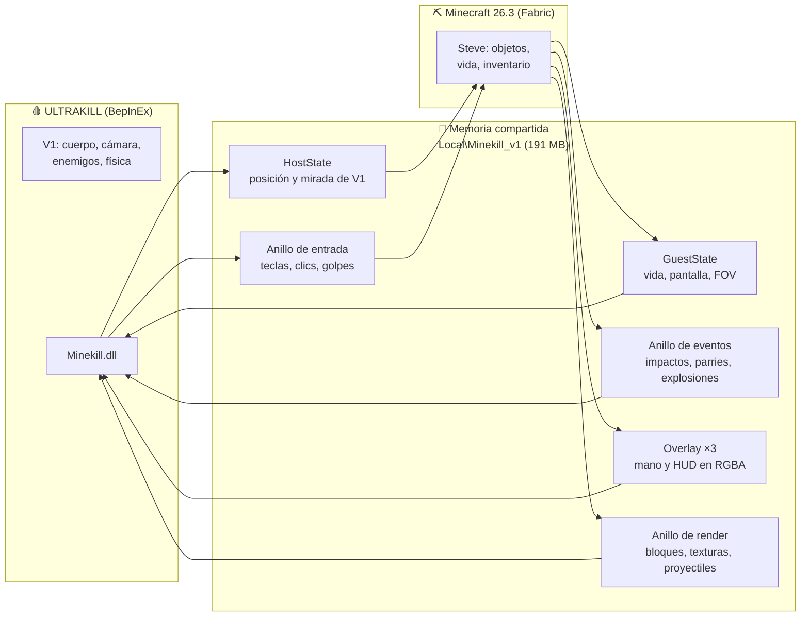

<div align="center">

# ⛏️ MINEKILL 🩸

### *Minecraft dentro de ULTRAKILL. De verdad.*

**Eres Steve. Estás en el Infierno. Llevas una espada de diamante, 16 TNT y un escudo.**
**Las máquinas no están preparadas.**


</div>

---

## 🤔 ¿Qué es esto?

MINEKILL **no** pega una ventana de Minecraft encima de ULTRAKILL. Ejecuta **los dos juegos a la vez** y los une por memoria compartida, para que cada uno haga lo que mejor sabe hacer:

| 🩸 ULTRAKILL se encarga de... | ⛏️ Minecraft se encarga de... |
|---|---|
| El cuerpo, el nivel, los enemigos y la física | Los objetos, el inventario, la vida y el hambre |
| Dibujar el mundo (los bloques usan su propio shader) | La mano, el objeto en mano y el HUD |
| El estilo, los parries y el gore | Daño, críticos, encantamientos y cooldowns |

Resultado: corres por los niveles de ULTRAKILL con la mano de Steve en pantalla, pones bloques sobre su geometría, enciendes TNT junto a un Malicious Face y le devuelves una bala de un parry con el escudo. 🛡️💥

---

## ✨ Lo que hay

### ⚔️ Combate cruzado
- **La espada de Minecraft golpea a los enemigos de ULTRAKILL.** Minecraft calcula el daño (alcance, cooldown, críticos, encantamientos) y ULTRAKILL lo aplica con su propio sistema, con estilo incluido.
- **Los golpes a V1 los recibe la vida de Steve**, así que la armadura cuenta. Si Steve muere, V1 muere.
- **Críticos al caer:** golpea mientras caes, como en Minecraft. 🌟
- **Botín** de enemigos de ULTRAKILL (flechas, TNT, perlas, diamantes, manzanas doradas... los jefes sueltan más).

### 🛡️ Parries de ULTRAKILL con objetos de Minecraft
- **Escudo levantado:** los proyectiles enemigos que te llegan se devuelven solos.
- **Escudo justo a tiempo** contra un ataque cuerpo a cuerpo: PARRY con su destello y su pausa.
- **Golpe con espada, arco o puño:** también hace parry, usando el puñetazo real de V1.

### 🧱 Bloques en el Infierno
- Pon y rompe bloques de Minecraft **sobre la geometría de ULTRAKILL**. Tienen colisión real, las texturas de tu Minecraft y la iluminación y la niebla del nivel.
- **El contorno de selección vanilla** marca el bloque al que apuntas.
- **TNT:** enciéndela con el mechero... o con una explosión de ULTRAKILL. Las reacciones en cadena funcionan. 💣

### 🏹 Proyectiles
- Flechas, bolas de nieve, huevos y perlas de ender vuelan **con la física de Minecraft dentro de ULTRAKILL**. Las flechas se clavan en las paredes y la perla te teletransporta (y duele, claro).
- **Bloodcraft:** la sangre de ULTRAKILL también cura a Steve. 🩸

### 🏃 Movimiento de Minecraft (tecla `M`)
- Andar, correr (Ctrl o doble W), agacharse sin caerte de los bordes (Shift) y el salto exacto de Minecraft.
- Gravedad, inercia y **daño por caída** que va a la vida de Steve.
- Velocidad ×1,5 por defecto, a medio camino entre Minecraft y ULTRAKILL (configurable).
- **Cámara de Minecraft:** su FOV (que se abre al correr y se cierra al tensar el arco), la altura de ojos de Steve y el balanceo al andar.

### 🎒 Inventario de verdad (tecla `E`)
- El inventario de Minecraft dentro de ULTRAKILL, con el cursor libre: arrastrar, Shift-clic, 1-9, Q, F... todo funciona. Esc lo cierra (y no pausa ULTRAKILL).

### 🔊 Sonidos de Minecraft
- Pasos según el bloque que pisas, golpes, críticos, arco, TNT, comer, dolor... sonando a la vez que la música de ULTRAKILL.

---

## 🎮 Controles

| Tecla | Acción |
|---|---|
| `º` (la de la izquierda del 1) | Alternar entre las armas de V1 y la **mano de Minecraft** |
| `M` | Alternar entre el movimiento de ULTRAKILL y el de **Minecraft** |
| `E` | Inventario de Minecraft |
| `1`-`9` / rueda | Barra rápida |
| Clic izquierdo | Atacar / romper bloque (y parry) |
| Clic derecho | Usar / poner bloque / escudo / comer / arco |
| `Ctrl` · `Shift` · `Espacio` | Correr · agacharse · saltar (en modo `M`) |
| `F10` | Panel de depuración |

Todas las teclas y ajustes se pueden cambiar en `BepInEx/config/dev.minekill.cfg`.

---

## 🧠 Cómo funciona



- **El protocolo** usa la disposición de memoria del protocolo v11 de [SkyCraft](https://github.com/chasmlol/SkyCraft), con seqlocks, anillos sin bloqueos y un overlay en triple búfer. Los mensajes propios de MINEKILL son los tipos 100 y siguientes.
- **Propiedad dividida:** ULTRAKILL manda sobre el cuerpo. En cada tick, Minecraft coloca a Steve donde está V1, sin gravedad. Minecraft manda sobre los objetos.
- **Cada API del juego se comprueba al arrancar** (`Compat.cs`). Si una actualización de ULTRAKILL cambia algo, esa función se desactiva y lo dice en el log, en lugar de romper el juego.
- **Los enemigos** se reflejan en Minecraft como cerdos invisibles y silenciosos que reciben los golpes de Steve. Ese daño se transfiere al enemigo real de ULTRAKILL.

---

## 📁 Estructura

```
bridge/Minekill.Link      Protocolo, memoria compartida, física de Minecraft (McPhysics), view bob (sin Unity, con tests)
plugin/Minekill.Plugin    Plugin de BepInEx para ULTRAKILL
mcmod/                    Mod de Fabric para Minecraft 26.3 (lado "guest")
tools/FakeHost            Juez de pruebas: hace de ULTRAKILL contra el Minecraft real
tools/FakeGuest           Lo contrario: hace de Minecraft
tools/ApiProbe            Lector de metadatos de ensamblados (comprueba APIs sin descompilar)
docs/CONTRACT.md          Propiedad, unidades, canales y ciclo de vida
docs/MODLOG.md            Registro de decisiones y evidencias de cada fase
```

---

## 🛠️ Compilar e instalar

> ⚠️ Necesitas tener **ULTRAKILL** y **Minecraft: Java Edition**. Este repo **no incluye ningún archivo de ninguno de los dos juegos**.

**Requisitos:** Windows, .NET SDK 8, JDK 25 y [BepInEx 5.4.23 x64](https://github.com/BepInEx/BepInEx/releases).

1. **Indica dónde está ULTRAKILL.** Por defecto se busca la carpeta de Steam; si lo tienes en otro sitio, crea `tools/local.ps1`:
   ```powershell
   $env:ULTRAKILL_DIR = "E:\Juegos\ULTRAKILL"
   ```
2. **Compila** las dos partes:
   ```powershell
   . .\tools\env.ps1
   dotnet build plugin\Minekill.Plugin -c Release
   cd mcmod; .\gradlew.bat build
   ```
3. **Instala el plugin.** Antes, haz una copia de seguridad del juego en `backups\ultrakill-pre-bepinex-<fecha>\` y descomprime BepInEx en `.tools\bepinex-pkg\`. Con ULTRAKILL cerrado:
   ```powershell
   powershell -ExecutionPolicy Bypass -File tools\install.ps1
   ```
   El instalador **solo añade archivos**: se niega a sobrescribir nada que no haya puesto él, y `uninstall.ps1` quita exactamente lo que añadió.
4. **¡A jugar!** Arranca Minecraft con `tools\run-minecraft.ps1`; se conecta solo. Luego abre ULTRAKILL, entra en un nivel y pulsa `º`.

---

## 🧪 Pruebas

Se desarrolló con TDD y con una regla: **ninguna función se da por buena solo porque compile.**

- **Tests unitarios:** C# (`dotnet test bridge\Minekill.Link.Tests`) y Java (`gradlew build`). Cubren el protocolo, los anillos, las coordenadas, la geometría de los cubos y la física de Minecraft (4,317 / 5,612 / 1,295 bloques/s, salto de 1,2522 bloques, daño por caída...).
- **Pruebas de integración contra Minecraft real** con `FakeHost`, que hace de ULTRAKILL:
  ```powershell
  dotnet run --project tools\FakeHost -c Release -- --combat     # espada contra enemigos, muerte de Steve
  dotnet run --project tools\FakeHost -c Release -- --blocks     # poner, romper, TNT
  dotnet run --project tools\FakeHost -c Release -- --synergy    # arco, perla, parry, cadena de TNT, crítico
  dotnet run --project tools\FakeHost -c Release -- --inventory  # E, cursor, clics, Esc
  dotnet run --project tools\FakeHost -c Release -- --bob        # balanceo de la mano y FOV al correr
  ```
- Toda la evidencia (logs, qué pasó y qué falló) está en [`docs/MODLOG.md`](docs/MODLOG.md).

---

## 🙏 Créditos

- **[SkyCraft](https://github.com/chasmlol/SkyCraft)** (MIT): la disposición de memoria del protocolo v11, la inyección de teclado y ratón en Minecraft y la creación automática del mundo (su `MirrorWorld`).
- **[Killcraft](https://github.com/goonsn/Killcraft)** (MIT): la técnica del puñetazo de V1 para los parries y la idea de saltarse `NewMovement`.
- **Hakita / New Blood** por ULTRAKILL y **Mojang** por Minecraft. MINEKILL es un mod de fans, sin afiliación con ninguno de ellos.

<div align="center">

---

*MANKIND IS DEAD. BLOCKS ARE FUEL. HELL IS FULL.* ⛏️🩸

</div>
